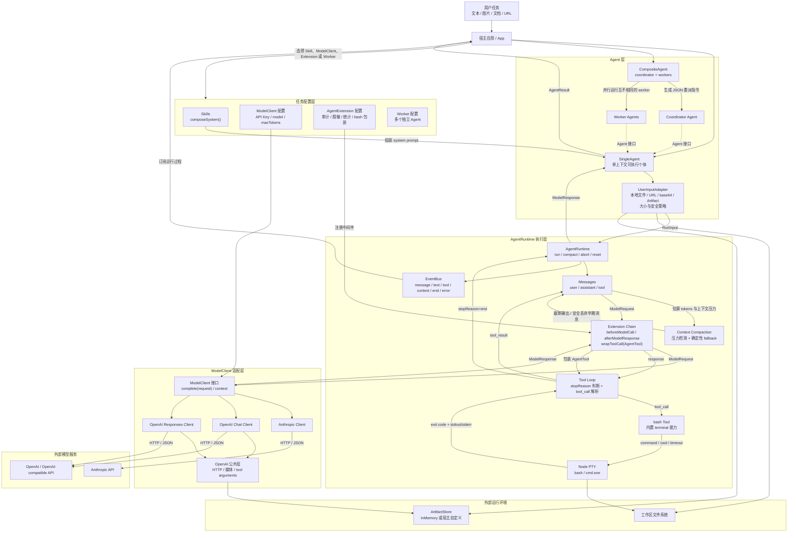

# mycoder 软件架构

## 关键依赖方向

- `Skills -> Agent/Runtime`：Skill 只生成声明式 system prompt，不新增执行通道。
- `Agent -> Runtime`：Agent 是对外抽象；Runtime 负责消息、模型调用、扩展和工具循环。
- `Runtime -> ModelClient`：Runtime 使用统一请求/响应格式；适配器负责模型协议转换。
- `Extension -> Runtime 请求/响应/工具链`：扩展按中间件顺序工作，但不能新增工具。
- `CompositeAgent -> Coordinator/Workers`：委派与结果都由 CompositeAgent 汇聚，worker 之间互不通信。
- `UserInputAdapter -> ArtifactStore`：本地输入默认进入受大小限制约束的 Artifact 引用，模型适配器再按协议转换。
